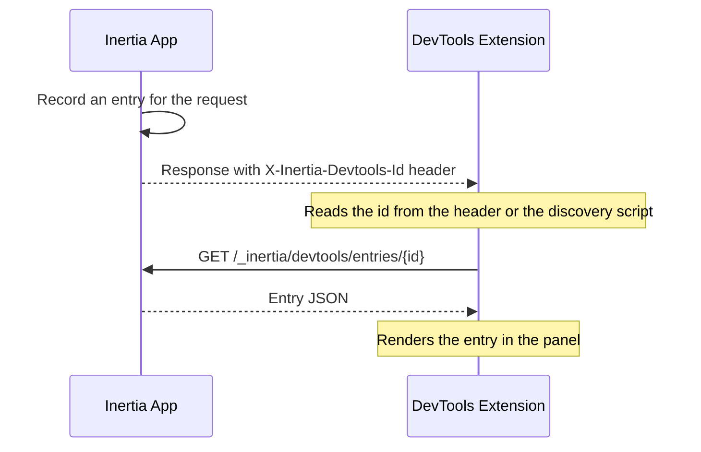

This page specifies the Inertia DevTools protocol. The [DevTools](/v3/advanced/devtools) page gives a high-level overview of the feature.

The DevTools extension works with any backend. Any server-side Inertia adapter may integrate with it by implementing this protocol. The Laravel adapter is the reference implementation, and nothing in this specification depends on Laravel.

The protocol has three layers:

1. **Discovery**: how the extension learns that the adapter recorded an entry.
2. **Correlation headers**: the request and response headers that link entries and group them.
3. **Read API**: the endpoints that return recorded entries, and the format of those entries.

While recording is enabled, a conforming adapter records one entry for each request it handles. It stores the entry under a generated id, separately for each browser tab, and returns it through the read API. The extension fetches each entry in a separate request. Recording adds discovery headers to each response and a discovery script to the initial HTML response, but the entry itself never appears in the application's response.



## Discovery

For every response, the adapter generates a unique entry id and sets it on a response header. The id may be any collision-resistant string of 1 to 256 characters, such as a ULID.

<ParamField header="X-Inertia-Devtools-Id" type="string">
  The generated id of the entry, set on every response. The extension reads the id from this header, then fetches the entry from the [read API](#the-read-api).
</ParamField>

The extension reads the id from the response header through a browser request listener. On the initial full-page HTML response, the adapter also adds a script element that holds the id. The extension's content script reads the id from that script after the document loads.

```html
<script data-inertia-devtools-id type="application/json">"<id>"</script>
```

The script contains the id as a JSON-encoded string.

An application served from a subpath, such as `/admin`, needs one more value. The extension sends read API requests to that subpath, so the adapter reports it.

<ParamField header="X-Inertia-Devtools-Base-Path" type="string">
  The path the application is served from, such as `/admin`. The adapter sets it only when the application is not served from the root of its origin. The adapter also adds the value to the discovery script as a `data-inertia-devtools-base-path` attribute.
</ParamField>

## Correlation Headers

The correlation headers link entries to client-side page state and group related requests. The extension sets the request headers, and the adapter stores their values on the entry. The adapter sets the response header.

The extension sends the following request headers. Each header is optional.

<ParamField header="X-Inertia-Devtools-Tab" type="string">
  A UUID for the browser tab, stored as `__meta.tabUuid`. The adapter stores entries separately for each tab, so one tab's history does not evict another tab's history.
</ParamField>

<ParamField header="X-Inertia-Devtools-Visit" type="string">
  The client's visit id, stored as `__meta.visitId`. The extension uses it to pair the entry with the page snapshot it took in the browser.
</ParamField>

<ParamField header="X-Inertia-Devtools-Parent" type="string">
  The id of the entry that started the batch, stored as `__meta.batchId`. The adapter stores the value unchanged. The client handles grouping.
</ParamField>

<ParamField header="X-Inertia-Devtools-Deferred" type="string">
  Set to `1` on the follow-up request for [deferred props](/v3/data-props/deferred-props). On the wire, that request looks like any [partial reload](/v3/data-props/partial-reloads), so the client marks it with this header.
</ParamField>

<ParamField header="X-Inertia-Devtools-Poll" type="string">
  Set to `1` on a [polling](/v3/data-props/polling) request. On the wire, a polling request also looks like a partial reload.
</ParamField>

The adapter sets the following response header.

<ParamField header="X-Inertia-Devtools-Parent-Out" type="string">
  The id of the batch root. The batch root is the `batchId` of the request, or the entry's own `id` when the request starts a batch. The client sends this value as `X-Inertia-Devtools-Parent` on its next follow-up request, such as a partial reload, a deferred props request, or a polling request. Every follow-up request then points at the root, which keeps the batch flat. A full navigation sends no parent header and starts a new batch, so a redirect and its target appear as separate roots. A [prefetch](/v3/data-props/prefetching) response returns its own `id` instead. The user may never visit a prefetched page, so a prefetch must not change the batch root for other requests.
</ParamField>

The adapter sets this header on every response. Without it, the client uses the response's `X-Inertia-Devtools-Id` as the next parent. Each follow-up request then attaches to the previous response instead of the batch root.

## The Read API

The read API has two endpoints at fixed paths below the application's [base path](#discovery). The adapter allows access to them only in development or for an authorized developer.

**`GET /_inertia/devtools/entries/{id}`** returns one [entry](#the-entry-format) as JSON, or a `404` response for an unknown id. The extension calls only this endpoint. It reads an id from the discovery script or the response header, then fetches that entry.

**`GET /_inertia/devtools/entries`** returns a JSON array of entry summaries, newest first. Each summary is the entry's `__meta` object. The extension does not call this endpoint, so it is optional. It serves tools that list a tab's history. An adapter may support the following optional query parameters:

- `component`: keep only entries for this exact component name.
- `type`: keep only entries with these request types, as a comma-separated list.
- `exclude`: drop entries with these request types, as a comma-separated list.
- `offset` and `limit`: page through the results.

A minimal adapter may ignore the parameters and return the summary of every stored entry.

The extension sends same-origin cookies with each request, so the adapter may authorize it.

## The Entry Format

An entry is a JSON object with required and optional fields.

The panel needs every required field. For a value that does not exist, the adapter emits the documented empty form or `null` instead of leaving the key out.

Optional fields add detail. An adapter may leave an optional field out, or emit `null` where the field's type allows it. The `propValues` map may also be `{}`. The panel still works with less detail. For example, it hides "open in editor" links when source locations are missing.

An adapter may add fields beyond this specification. The extension ignores unknown fields instead of rejecting the entry.

A fully populated entry for a standard navigation looks like this.

```json
{
    "__meta": {
        "id": "01ARZ3NDEKTSV4RRFFQ69G5FAV",
        "tabUuid": "123e4567-e89b-42d3-a456-426614174000",
        "batchId": null,
        "timestamp": "2026-07-09T10:00:00.123Z",
        "utime": 1783591200.123,
        "method": "GET",
        "url": "http://localhost/users",
        "component": "Users/Index",
        "requestType": "navigate",
        "status": 200,
        "redirectLocation": null,
        "serverTimingMs": 12.5,
        "visitId": "visit-1"
    },
    "http": {
        "requestHeaders": { "x-inertia": "true" },
        "responseHeaders": { "content-type": "application/json" },
        "requestBody": { "status": "empty" },
        "responseBody": {
            "status": "present",
            "value": {
                "component": "Users/Index",
                "props": { "name": "Alice" },
                "flash": { "message": "User created" }
            }
        }
    },
    "props": {
        "name": { "shared": false },
        "errors": { "inertiaType": "always", "shared": true, "shareSource": { "file": "Middleware.php", "line": 72 } }
    },
    "propValues": { "name": "Alice", "errors": {} },
    "route": {
        "name": "users.index",
        "uri": "/users",
        "action": "App\\Http\\Controllers\\UsersController@index",
        "actionSource": { "file": "UsersController.php", "line": 15 }
    },
    "renderSource": { "file": "UsersController.php", "line": 17 },
    "componentPath": "resources/js/Pages/Users/Index.vue"
}
```

The following sections describe each field.

### Meta

The `__meta` object carries the entry's identity and summary.

<ParamField body="id" type="string" required>
  Matches the `X-Inertia-Devtools-Id` for this response.
</ParamField>

<ParamField body="method" type="string" required>
  The HTTP method.
</ParamField>

<ParamField body="url" type="string" required>
  The absolute request URL.
</ParamField>

<ParamField body="status" type="number" required>
  The HTTP status code.
</ParamField>

<ParamField body="requestType" type="string" required>
  One of the [request types](#request-type-derivation).
</ParamField>

<ParamField body="component" type="string | null" required>
  The Inertia page component, or `null` for a response that rendered no Inertia page.
</ParamField>

<ParamField body="timestamp" type="string" required>
  The time of the request in ISO 8601 format, used for display.
</ParamField>

<ParamField body="utime" type="number" required>
  The time of the request in seconds since the Unix epoch, as a float. The panel uses it for stable ordering.
</ParamField>

<ParamField body="tabUuid" type="string | null" required>
  The value of `X-Inertia-Devtools-Tab`, or `null` when the request carries no tab header. The extension adds the header only for hosts where it has discovered an entry before, and it remembers those hosts. A request to a host it has not discovered yet has no tab header.
</ParamField>

<ParamField body="batchId" type="string | null" required>
  The value of `X-Inertia-Devtools-Parent`. A `null` value starts a new batch.
</ParamField>

<ParamField body="serverTimingMs" type="number | null" required>
  The server processing time in milliseconds, or `null` when unavailable.
</ParamField>

<ParamField body="redirectLocation" type="string | null">
  The redirect target of a `3xx` response or an Inertia location response.
</ParamField>

<ParamField body="visitId" type="string | null">
  The value of `X-Inertia-Devtools-Visit`.
</ParamField>

<Note>
`timestamp` and `utime` describe the same instant in two forms. `timestamp` keeps a stored entry readable on its own. `utime` has sub-millisecond precision, and the panel orders and groups entries by it. The adapter derives both values from the same instant.
</Note>

### HTTP

The `http` object and each of its keys are required. With nothing to show, the adapter emits the empty form.

```ts
http: {
    requestHeaders:  Record<string, string>   // may be {}
    responseHeaders: Record<string, string>   // may be {}
    requestBody:     BodyCapture
    responseBody:    BodyCapture
}
```

`BodyCapture` is a tagged union.

```ts
| { status: 'empty' }
| { status: 'present', value: <json tree or raw string> }
| { status: 'omitted', reason: string }
```

`value` is a string for a raw text body. For structured data, such as parsed JSON or form input, it is a JSON-compatible value. The panel recognizes the following `omitted` reasons: `non-inertia-response`, `non-inertia-request`, `non-textual`, `streamed`, `too-large`, `unserializable`, and `binary`. It shows a readable notice for each one, and a generic message for an unknown reason, so an adapter may add new reasons. Adapters redact sensitive keys and summarize file uploads instead of serializing binary content.

### Props

<ParamField body="props" type="Record<string, PropMeta>" required>
  Metadata for each prop, keyed by dotted path. The panel builds its prop tree from this map and adds intermediate nodes for dotted paths. A listed prop without metadata children shows its nested values from `propValues`, so those nested paths need no entries of their own. A prop with metadata children shows the child rows instead. An adapter that cannot classify a top-level prop still lists it, with empty metadata. With `props` set to `{}`, the panel shows no props, even when `propValues` contains values.

  <Expandable title="PropMeta">
    Every field is optional. Source locations are `{ file: string, line: number }`.

    <ParamField body="inertiaType" type="'always' | 'defer' | 'optional' | 'merge' | 'scroll' | 'once'" />
    <ParamField body="shared" type="boolean">
      Whether the prop path matches a top-level [shared](/v3/data-props/shared-data) key. A page prop with the same key overrides the shared value, but the Laravel adapter still marks the path as shared.
    </ParamField>
    <ParamField body="deferGroup" type="string" />
    <ParamField body="reset" type="boolean" />
    <ParamField body="once" type="boolean">
      Set for a [once prop](/v3/data-props/once-props). The client reuses its value on later visits until the value expires or the server refreshes it.
    </ParamField>
    <ParamField body="mergeDirection" type="'append' | 'prepend'">
      How a [merge](/v3/data-props/merging-props) or [scroll](/v3/data-props/infinite-scroll) prop combines with existing client data.
    </ParamField>
    <ParamField body="deepMerge" type="boolean">
      Set alongside `mergeDirection` for a deep merge.
    </ParamField>
    <ParamField body="rescued" type="boolean">
      Set for a deferred prop that threw and that the adapter rescued. The prop has no value in this response.
    </ParamField>
    <ParamField body="renderSource" type="{ file, line }" />
    <ParamField body="shareSource" type="{ file, line }" />
  </Expandable>
</ParamField>

<ParamField body="propValues" type="Record<string, unknown>">
  The resolved prop values, keyed by dotted path. The adapter replaces sensitive values with `"[REDACTED]"`. It may leave the field out or send `{}`, and the panel handles both.
</ParamField>

### Route

<ParamField body="route.uri" type="string" required>
  The matched route path, or `""` when no route matched.
</ParamField>

<ParamField body="route.name" type="string | null" required>
  The route name, or `null` for an unnamed route.
</ParamField>

<ParamField body="route.action" type="string | null" required>
  The controller or handler identifier, or `null` when none applies.
</ParamField>

<ParamField body="route.actionSource" type="{ file, line }">
  The source location of the handler.
</ParamField>

<ParamField body="renderSource" type="{ file, line } | null" required>
  The source location of the render call, or `null` when the adapter cannot resolve it.
</ParamField>

<ParamField body="componentPath" type="string | null" required>
  The path of the component file, or `null` when the adapter cannot resolve it.
</ParamField>

The source location fields provide the "open in editor" links. An adapter that cannot resolve them cheaply emits `null` and loses only those links.

## Request Type Derivation

The adapter derives the request type from the request headers, including the two DevTools hint headers. It checks the following conditions in order and uses the first match.

| Order | Condition | Request type |
| --- | --- | --- |
| 1 | The [Precognition](/v3/the-basics/forms#precognition) header is present | `precognition` |
| 2 | Not an Inertia request, and the adapter rendered an Inertia page | `initial` |
| 3 | Not an Inertia request, and the adapter rendered no Inertia page | `http` |
| 4 | `X-Inertia-Devtools-Deferred` is present | `deferred` |
| 5 | `X-Inertia-Devtools-Poll` is present | `poll` |
| 6 | `X-Inertia-Partial-Component` is present | `partial` |
| 7 | `Purpose: prefetch` is present | `prefetch` |
| 8 | None of the above | `navigate` |

`initial` and `http` are both non-Inertia requests. The adapter tells them apart by whether it rendered an Inertia page. The application's initial full-page load renders a page, so its `component` is set and its type is `initial`. A plain JSON or text endpoint that the application serves next to Inertia renders no page, so its `component` is `null` and its type is `http`. The adapter knows which kind of response it produced, so it sets the type instead of leaving the panel to work it out.

The `client-visit` and `cache-hit` types are client-only and never come from an adapter.

## Storage Semantics

An adapter keeps recent entries and evicts old ones. It usually limits the number of entries for each `tabUuid`, so a busy tab cannot evict another tab's history. It also removes entries older than a time limit. The adapter chooses these limits. The protocol requires only that the read API return the stored entries, newest first.
