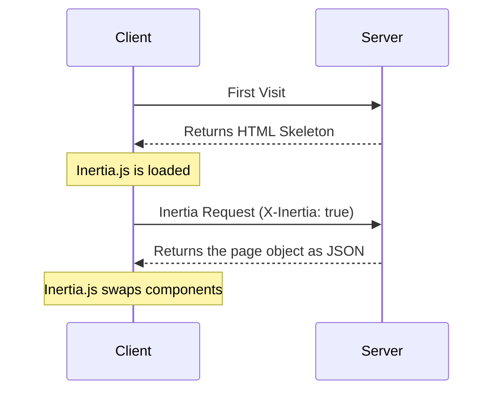

This page specifies the Inertia protocol, the wire contract between the Inertia client and your server. The [how it works](/v3/core-concepts/how-it-works) page gives a high-level overview.

The protocol is framework-agnostic. Any backend that speaks HTTP may implement it, in any language. The official Laravel adapter is the reference implementation, and the requests and responses on this page show its output. Placeholders such as `...` and comments shorten the longer examples. The [building an adapter](/v3/advanced/building-an-adapter) guide explains how to structure an implementation around this specification.

## Request Lifecycle Diagram

The following diagram shows the request lifecycle of an Inertia application. The first visit is a standard request. The server returns an HTML document with a root element and a script element that holds the page object. With SSR enabled, the root element also contains server-rendered markup, which the client hydrates. Later visits are XHR requests that return JSON. Inertia applies each JSON response and swaps the page component without a full-page reload.



## HTML Responses

The first request to an Inertia app is a regular full-page browser request, with no Inertia headers. The server answers it with a complete HTML document.

The document loads the site's CSS and JavaScript and contains a root `<div>`, where the client-side app mounts. A `<script type="application/json">` element holds the JSON-encoded [page object](#the-page-object) for the initial page. The script's `data-page` attribute matches the root element's `id`. Inertia reads the page object from this script, boots your client-side framework, and renders the initial page component. Earlier Inertia versions stored the page object in a `data-page` attribute on the root `<div>`. The current client does not read that attribute.

```http
REQUEST
GET: https://example.com/events/80
Accept: text/html, application/xhtml+xml

RESPONSE
HTTP/1.1 200 OK
Content-Type: text/html; charset=utf-8

<html>
    <head>
        <title>My app</title>
        <link href="/css/app.css" rel="stylesheet">
        <script src="/js/app.js" defer></script>
    </head>
    <body>
        <script data-page="app" type="application/json">{"component":"Event","props":{"errors":{},"event":{"id":80,"title":"Birthday party","start_date":"2019-06-02","description":"Come out and celebrate Jonathan's 36th birthday party!"}},"url":"\/events\/80","version":"c32b8e4965f418ad16eaebba1d4e960f"}</script>
        <div id="app"></div>
    </body>
</html>
```

<Warning>
  The serialized page object MUST NOT contain a literal `</script>` sequence. That sequence closes the script element early and breaks the page. Escaping forward slashes (`/` becomes `\/`) or the `<` character (`<` becomes `\u003C`) prevents it. The Laravel adapter escapes both, so the example above contains `"\/events\/80"`. The server MUST NOT use HTML-entity encoding here. The browser does not decode entities inside a script element, so JSON parsing fails.
</Warning>

## Inertia Responses

After the app boots, Inertia makes every later request with XHR and sets the `X-Inertia` header to `true`. The header marks the request as an Inertia visit rather than a full-page visit.

The server detects the `X-Inertia` header and returns the [page object](#the-page-object) as JSON instead of an HTML document.

```http
REQUEST
GET: https://example.com/events/80
Accept: text/html, application/xhtml+xml
X-Requested-With: XMLHttpRequest
X-Inertia: true
X-Inertia-Version: 6b16b94d7c51cbe5b1fa42aac98241d5

RESPONSE
HTTP/1.1 200 OK
Content-Type: application/json
Vary: X-Inertia
X-Inertia: true

{
    "component": "Event",
    "props": {
        "errors": {},
        "event": {
            "id": 80,
            "title": "Birthday party",
            "start_date": "2019-06-02",
            "description": "Come out and celebrate Jonathan's 36th birthday party!"
        }
    },
    "url": "/events/80",
    "version": "6b16b94d7c51cbe5b1fa42aac98241d5",
    "encryptHistory": true
}
```

## How the Client Handles Responses

The client inspects each response before it changes the page, and handles the response by these rules:

- **An Inertia response (`X-Inertia: true`)**: the client applies the page object and swaps the component.
- **A `409 Conflict` with `X-Inertia-Location`**: the client makes a full `window.location` visit to that URL, which loads fresh assets. A background request skips this visit when the asset version changed, because a reload the user did not start would discard unsaved state.
- **A `409 Conflict` with `X-Inertia-Redirect`**: the client makes a new Inertia `GET` visit to that URL.
- **Any other response**, such as an HTML document, plain JSON, or an error page: the client treats it as an exception. It fires a cancelable HTTP exception event and shows an error modal unless a listener cancels the event.

Standard `3xx` redirects never reach these rules. The browser follows them and sends the same request headers to the new location. `X-Inertia` therefore reaches the redirect target, and the client inspects only the final response in the chain. The [redirects](#redirects) section lists the statuses a server returns to control this.

An Inertia response with a status of `400` or greater fires the same cancelable HTTP exception event before the client renders it. Canceling the event stops the render, so the application may handle the failure itself.

## Request Headers

The Inertia client sends the following request headers.

<ParamField header="X-Inertia" type="boolean">
  Set to `true` on every Inertia request.
</ParamField>

<ParamField header="X-Requested-With" type="string">
  Set to `XMLHttpRequest` on all Inertia requests.
</ParamField>

<ParamField header="Accept" type="string">
  Set to `text/html, application/xhtml+xml`.
</ParamField>

<ParamField header="Content-Type" type="string">
  Set to `application/json` for requests with a JSON body. Requests without a
  body, such as `GET` requests, omit it.
</ParamField>

<ParamField header="X-Inertia-Version" type="string">
  The asset version of the current page. The client omits the header when the
  version is an empty string.
</ParamField>

<ParamField header="X-XSRF-TOKEN" type="string">
  The CSRF token read from the `XSRF-TOKEN` cookie. The cookie and header names
  are configurable.
</ParamField>

<ParamField header="Purpose" type="string">
  Set to `prefetch` on [prefetch](/v3/data-props/prefetching) requests.
</ParamField>

<ParamField header="X-Inertia-Partial-Component" type="string">
  The component name for [partial reloads](/v3/data-props/partial-reloads).
</ParamField>

<ParamField header="X-Inertia-Partial-Data" type="string">
  Comma-separated list of props to include in a partial reload.
</ParamField>

<ParamField header="X-Inertia-Partial-Except" type="string">
  Comma-separated list of props to exclude from a partial reload.
</ParamField>

<ParamField header="X-Inertia-Reset" type="string">
  Comma-separated list of props to [reset](#resetting-props).
</ParamField>

<ParamField header="Cache-Control" type="string">
  Set to `no-cache` on reload requests, so caches do not serve stale content.
</ParamField>

<ParamField header="X-Inertia-Error-Bag" type="string">
  The name of the error bag for [validation errors](#validation-errors).
</ParamField>

<ParamField header="X-Inertia-Infinite-Scroll-Merge-Intent" type="string">
  Whether the client appends or prepends the requested page of an
  [infinite scroll](/v3/data-props/infinite-scroll) prop.
</ParamField>

<ParamField header="X-Inertia-Except-Once-Props" type="string">
  Comma-separated list of the [once prop](#once-props) keys that the client
  has loaded and that have not expired. The server skips these props unless a
  partial reload requests them or the server refreshes them.
</ParamField>

[Precognition](/v3/the-basics/forms#precognition) validation requests use the following headers.

<ParamField header="Precognition" type="boolean">
  Set to `true` on a Precognition validation request.
</ParamField>

<ParamField header="Precognition-Validate-Only" type="string">
  Comma-separated list of field names to validate.
</ParamField>

## Response Headers

The server sets the following headers on an Inertia JSON response.

<ParamField header="X-Inertia" type="boolean">
  Set to `true` on an Inertia response.
</ParamField>

<ParamField header="Vary" type="string">
  Set to `X-Inertia`, so browsers and caches keep the HTML response and the
  JSON response for one URL apart.
</ParamField>

The following headers appear on `409 Conflict` control responses. A `409` response tells the client to navigate rather than render a page, so it carries no `X-Inertia` header.

<ParamField header="X-Inertia-Location" type="string">
  The destination URL for a full `window.location` visit. Set on an external
  redirect and on an asset version mismatch.
</ParamField>

<ParamField header="X-Inertia-Redirect" type="string">
  The full redirect URL, including its fragment, for a redirect whose target
  contains a URL fragment. The client makes a new Inertia `GET` visit instead of
  a full-page reload.
</ParamField>

<ParamField header="X-Inertia-Version" type="string">
  The server's current asset version, set on a version mismatch `409`.
</ParamField>

[Precognition](/v3/the-basics/forms#precognition) validation responses use the following headers.

<ParamField header="Precognition" type="string">
  Set to `true` on a Precognition validation response.
</ParamField>

<ParamField header="Precognition-Success" type="string">
  Set to `true`, with a `204 No Content` status, when validation passes.
</ParamField>

<ParamField header="Vary" type="string">
  Set to `Precognition` on every response that passes through the Precognition
  middleware.
</ParamField>

## The Page Object

The server and the client exchange data through the page object. The page object holds what the client needs to render the page component, update the browser's history state, and track the site's asset version. It may contain the following properties.

<ParamField body="component" type="string">
  The name of the JavaScript page component.
</ParamField>

<ParamField body="props" type="object">
  The page props. Usually includes an [`errors`](#validation-errors) object.
</ParamField>

<ParamField body="url" type="string">
  The page URL.
</ParamField>

<ParamField body="version" type="string">
  The current [asset version](/v3/advanced/asset-versioning).
</ParamField>

<ParamField body="encryptHistory" type="boolean">
  Whether the client [encrypts the page's history
  state](/v3/security/history-encryption). Included only when `true`.
</ParamField>

<ParamField body="clearHistory" type="boolean">
  Whether the client [clears encrypted history
  state](/v3/security/history-encryption#clearing-history). Included only when `true`.
</ParamField>

<ParamField body="preserveBigIntegers" type="boolean">
  Whether the props wrap integers outside JavaScript's safe range as `{"$bigint": "<digits>"}` markers. The client turns each marker into a [`BigInt` value](/v3/advanced/big-integers). Included only when `true`.
</ParamField>

<ParamField body="preserveFragment" type="boolean">
  Whether the client [keeps the URL fragment](/v3/the-basics/redirects#preserving-fragments) of the original request after a redirect. Included only when `true`.
</ParamField>

<ParamField body="mergeProps" type="array">
  Prop keys whose new values the client [appends](/v3/data-props/merging-props)
  to the existing values.
</ParamField>

<ParamField body="prependProps" type="array">
  Prop keys whose new values the client [prepends](/v3/data-props/merging-props)
  to the existing values.
</ParamField>

<ParamField body="deepMergeProps" type="array">
  Prop keys whose new values the client [deep
  merges](/v3/data-props/merging-props#deep-merge) into the existing values.
</ParamField>

<ParamField body="matchPropsOn" type="array">
  The fields that identify items when the client [merges
  props](#matching-items).
</ParamField>

<ParamField body="scrollProps" type="object">
  The pagination state of each [infinite scroll](#infinite-scroll) prop.
</ParamField>

<ParamField body="deferredProps" type="object">
  The [deferred props](#deferred-and-optional-props) that the client loads in
  follow-up requests, grouped by request group.
</ParamField>

<ParamField body="rescuedProps" type="array">
  The keys of [deferred props](#rescued-deferred-props) that threw and that
  the server rescued. The client renders the `rescue` slot of the `<Deferred>`
  component for these props.
</ParamField>

<ParamField body="sharedProps" type="array">
  The top-level keys of the [shared props](/v3/data-props/shared-data). The
  client carries these props over during [instant
  visits](/v3/the-basics/instant-visits).
</ParamField>

<ParamField body="onceProps" type="object">
  The [once props](#once-props) of the page. Each entry maps a key to an object
  with the `prop` name and an `expiresAt` timestamp in milliseconds, or `null`
  for no expiry.
</ParamField>

<ParamField body="flash" type="object">
  The flash data for the current request. Included only when flash data
  exists. The client exposes it through the `inertia:flash` event and leaves it
  out of the saved history state.
</ParamField>

Every page object contains `component`, `props`, `url`, and `version`. A minimal page object looks like this.

```json
{
  "component": "User/Edit",
  "props": {
    "errors": {},
    "user": {
      "name": "Jonathan"
    }
  },
  "url": "/user/123",
  "version": "6b16b94d7c51cbe5b1fa42aac98241d5"
}
```

The server emits the other fields only when they apply. The client reads a missing field as an empty array, an empty object, or `false`. A server may therefore omit an empty field or send it, with the same result.

## Prop Evaluation Model

Every prop belongs to one or more categories. The category decides whether the server resolves the prop for a request, and which metadata fields describe it. These rules apply only on the server. The client applies whatever metadata it receives.

Resolution differs between the two request modes. A full visit resolves every eligible prop. A partial reload resolves only the props that the client requests for the same page component.

**Full visit**

| Prop category                | Resolved?                                | Metadata emitted                                               |
| :--------------------------- | :--------------------------------------- | :------------------------------------------------------------- |
| Regular                      | Yes                                      | none                                                           |
| Always                       | Yes, ignoring `only` and `except`        | none                                                           |
| Optional                     | No, and not announced                    | none                                                           |
| Deferred                     | No, but announced                        | `deferredProps`                                                |
| Merge, deep merge, prepend   | Yes                                      | `mergeProps`, `deepMergeProps`, `prependProps`, `matchPropsOn` |
| Once                         | Yes, unless already remembered by client | `onceProps`                                                    |
| Scroll                       | Yes                                      | `scrollProps`, `mergeProps`                                    |

**Partial reload**

| Prop category                | Resolved?                                | Metadata emitted                                               |
| :--------------------------- | :--------------------------------------- | :------------------------------------------------------------- |
| Regular                      | Only when `only` or `except` selects it  | none                                                           |
| Always                       | Yes, ignoring `only` and `except`        | none                                                           |
| Optional                     | Only when `only` or `except` selects it  | none                                                           |
| Deferred                     | Only when `only` or `except` selects it  | `rescuedProps`, when rescued                                   |
| Merge, deep merge, prepend   | When resolved                            | `mergeProps`, `deepMergeProps`, `prependProps`, `matchPropsOn` |
| Once                         | When requested, ignoring except-once     | `onceProps`                                                    |
| Scroll                       | When resolved                            | `scrollProps`, `mergeProps`                                    |

Some metadata fields depend on the mode:

- `deferredProps` appears only on full visits. Deferred props resolve in the follow-up partial reload, so `deferredProps` is empty or absent there.
- `rescuedProps` appears only on partial reloads. It lists the deferred props that failed to resolve.
- Merge, scroll, and once metadata appears on each response that contains props with those behaviors.

### Always Props

The server resolves always props on every response in both modes. Always props ignore the partial reload filters, so the server sends an always prop even when the request lists it in `except`. They carry no metadata. The Laravel adapter's middleware shares the `errors` prop as an always prop. Its page objects therefore include an `errors` object, unless a page prop overrides it.

### Composing Categories

A prop may belong to several categories, such as deferred and mergeable, once and deferred, or scroll and deferred. The metadata fields are independent. The page object carries every label that applies, subject to the mode, the partial reload filters, and the reset rules.

## Partial Reloads

A partial reload requests a subset of the props on a later visit to the same page component. The [partial reloads](/v3/data-props/partial-reloads) page covers the client-side API.

A partial reload request carries the `X-Inertia-Partial-Component` header. It may also carry `X-Inertia-Partial-Data`, `X-Inertia-Partial-Except`, or both.

- `X-Inertia-Partial-Data` lists the prop keys to return.
- `X-Inertia-Partial-Except` lists the prop keys to leave out. Sent alone, it returns every prop except the listed ones.
- With both headers, the server first narrows the response to the `X-Inertia-Partial-Data` list, then removes the `X-Inertia-Partial-Except` list. A prop named in both headers is left out.

Entries in both headers may be dot-notated paths, such as `auth.user`, which select or exclude a nested prop. The Laravel adapter applies nested paths only inside plain arrays. It returns a prop that a closure resolves in full.

`X-Inertia-Partial-Component` holds the name of the page component being reloaded. Partial reloads apply only to the same page component. The server resolves a request that ends on a different component as a full visit. A login page after the session expired is a common example.

```http
REQUEST
GET: https://example.com/events
Accept: text/html, application/xhtml+xml
X-Requested-With: XMLHttpRequest
X-Inertia: true
X-Inertia-Version: 6b16b94d7c51cbe5b1fa42aac98241d5
X-Inertia-Partial-Data: events
X-Inertia-Partial-Component: Events

RESPONSE
HTTP/1.1 200 OK
Content-Type: application/json

{
    "component": "Events",
    "props": {
        "events": [...], // the requested prop
        "errors": {}     // always included
    },
    "url": "/events",
    "version": "6b16b94d7c51cbe5b1fa42aac98241d5"
}
```

### Resetting Props

The `X-Inertia-Reset` header lists the prop paths that the client resets before it applies new data. The client sends each reset path in both `X-Inertia-Reset` and `X-Inertia-Partial-Data`. The server resolves a reset prop again and returns it in `props` without a merge label, so the client replaces the value instead of merging it. For a scroll prop, the server also sets `scrollProps[path].reset`. The [infinite scroll](/v3/data-props/infinite-scroll) component then resets its pagination state to the returned page. The [resetting props](/v3/data-props/merging-props#resetting-props) section covers the client-side API.

## Deferred and Optional Props

A deferred prop is data that the client loads in a follow-up request. On a full visit, the server skips the prop and lists its key under `deferredProps`, grouped by request group. Group names are arbitrary. The client sends one partial reload per group. The [deferred props](/v3/data-props/deferred-props) page covers the server and client APIs.

```json
{
  "component": "Posts/Index",
  "props": {
    "errors": {},
    "user": {
      "name": "Jonathan"
    }
  },
  "url": "/posts",
  "version": "6b16b94d7c51cbe5b1fa42aac98241d5",
  "deferredProps": {
    "default": ["comments", "analytics"],
    "sidebar": ["relatedPosts"]
  }
}
```

Optional props are never announced. The server skips them on full visits and resolves them only when a partial reload selects them with `only` or `except`.

### Rescued Deferred Props

A rescued deferred prop that throws does not fail the response. The response is still a `200` with every other prop. The server reports the exception through the framework's error handling and leaves the prop out of `props`. It does not send the prop as `null`. The server adds the key to the top-level `rescuedProps` array, and the client renders the `rescue` slot of the `<Deferred>` component for it. The [error handling](/v3/data-props/deferred-props#error-handling) section covers the server and client APIs.

```json
{
  "component": "Users/Index",
  "props": {
    "errors": {}
  },
  "url": "/users",
  "version": "6b16b94d7c51cbe5b1fa42aac98241d5",
  "rescuedProps": ["permissions"]
}
```

## Merging Props

A merge prop tells the client to combine new data with the data already on the page instead of replacing it. The client appends or prepends arrays and merges objects, either shallowly or deeply. The page object labels each merge prop under `mergeProps` to append, `prependProps` to prepend, or `deepMergeProps` to deep merge. The client merges only on partial reloads. A full visit replaces the prop, even when the prop carries a merge label. The [merging props](/v3/data-props/merging-props) page covers the server and client APIs.

```json
{
  "component": "Feed/Index",
  "props": {
    "errors": {},
    "user": {
      "name": "Jonathan"
    },
    "posts": [
      {
        "id": 1,
        "title": "First Post"
      }
    ],
    "notifications": [
      {
        "id": 2,
        "message": "New comment"
      }
    ],
    "conversations": {
      "data": [
        {
          "id": 1,
          "title": "Support Chat",
          "participants": ["John", "Jane"]
        }
      ]
    }
  },
  "url": "/feed",
  "version": "6b16b94d7c51cbe5b1fa42aac98241d5",
  "mergeProps": ["posts"],
  "prependProps": ["notifications"],
  "deepMergeProps": ["conversations"],
  "matchPropsOn": ["posts.id", "notifications.id", "conversations.data.id"]
}
```

### Matching Items

The `matchPropsOn` array names the field that identifies each item. The client uses that field to update an existing item in place instead of adding a duplicate. Each entry has the form `"<propPath>.<keyField>"`, and the client splits it at the last dot. The text before the last dot is the prop path, and the final segment is the key field. `conversations.data.id` matches items of the array at `conversations.data` by their `id` field. The [matching items](/v3/data-props/merging-props#matching-items) section covers the server-side API.

## Once Props

The server resolves a once prop on its first use. The client remembers the value and reuses it on later pages that include the same prop, until the value expires or the server refreshes it. The page object carries an `onceProps` object. Each entry maps a key to the prop name and an expiration timestamp in milliseconds, or `null` for no expiry. The [once props](/v3/data-props/once-props) page covers the server and client APIs.

```json
{
  "component": "Billing/Plans",
  "props": {
    "errors": {},
    "plans": [
      {
        "id": 1,
        "name": "Basic"
      },
      {
        "id": 2,
        "name": "Pro"
      }
    ]
  },
  "url": "/billing/plans",
  "version": "6b16b94d7c51cbe5b1fa42aac98241d5",
  "onceProps": {
    "plans": {
      "prop": "plans",
      "expiresAt": null
    }
  }
}
```

On later Inertia requests, the client sends the keys of loaded once props that have not expired in the `X-Inertia-Except-Once-Props` header. The server skips those props and leaves them out of the response, except in the cases that [force-fresh and partial reloads](#force-fresh-and-partial-reloads) describes. The client reuses the values it already has.

```http
REQUEST
GET: https://example.com/billing/upgrade
Accept: text/html, application/xhtml+xml
X-Requested-With: XMLHttpRequest
X-Inertia: true
X-Inertia-Version: 6b16b94d7c51cbe5b1fa42aac98241d5
X-Inertia-Except-Once-Props: plans

RESPONSE
HTTP/1.1 200 OK
Content-Type: application/json

{
    "component": "Billing/Upgrade",
    "props": {
        "errors": {},
        "currentPlan": {
            "id": 1,
            "name": "Basic"
        }
    },
    "url": "/billing/upgrade",
    "version": "6b16b94d7c51cbe5b1fa42aac98241d5",
    "onceProps": {
        "plans": {
            "prop": "plans",
            "expiresAt": null
        }
    }
}
```

The response lists `plans` in `onceProps` but not in `props`, because the client already has the value. The `onceProps` key identifies the once prop across pages, and `prop` holds the prop name. The two differ when the application uses [custom keys](/v3/data-props/once-props#custom-keys).

### Force-Fresh and Partial Reloads

The server may send a new value for a once prop even when `X-Inertia-Except-Once-Props` lists its key, for example after the underlying data changes. The new value and its `expiresAt` replace the client's copy. The server ignores the except-once header on a partial reload, so it always resolves a requested once prop.

## Infinite Scroll

Infinite scroll builds on merge props. The server labels the prop's inner array for merging, usually at `<path>.data`. The page object also carries a `scrollProps` entry that describes the pagination state. The [infinite scroll](/v3/data-props/infinite-scroll) page covers the server and client APIs.

```json
{
  "component": "Posts/Index",
  "props": {
    "errors": {},
    "posts": {
      "data": [
        {
          "id": 1,
          "title": "First Post"
        },
        {
          "id": 2,
          "title": "Second Post"
        }
      ]
    }
  },
  "url": "/posts?page=1",
  "version": "6b16b94d7c51cbe5b1fa42aac98241d5",
  "mergeProps": ["posts.data"],
  "scrollProps": {
    "posts": {
      "pageName": "page",
      "previousPage": null,
      "nextPage": 2,
      "currentPage": 1,
      "reset": false
    }
  }
}
```

Every scroll response repeats the merge label and sends the current pagination state. On a reset request, the server also sets `scrollProps[path].reset` to `true`, and the client resets its pagination state to the returned page. A deferred scroll prop emits no `scrollProps` on the full visit, because it resolves in the follow-up request.

## Asset Versioning

The `version` field of the page object identifies the current version of the site's assets. It may be any string that changes when the assets change, such as a file hash. A server that does not track asset versions sends an empty string. The client sends a non-empty version back in the `X-Inertia-Version` header. The server compares the two values, usually in middleware, and treats a missing header as an empty string.

Matching versions let the request continue. On a `GET` request with a mismatch, the server returns a `409 Conflict`. The `X-Inertia-Location` header holds the full URL of the request, and `X-Inertia-Version` holds the server's current version. For a visit the user started, the client then makes a full-page visit to that URL, which follows any server-side redirect to the final page. For a background request, the client keeps the current page, as described in [how the client handles responses](#how-the-client-handles-responses). A non-`GET` request never receives a mismatch `409`, but the `GET` redirect that follows it may. On a version mismatch, the server also keeps the session's flash data for the next request.

```http
REQUEST
GET: https://example.com/events/80
Accept: text/html, application/xhtml+xml
X-Requested-With: XMLHttpRequest
X-Inertia: true
X-Inertia-Version: 6b16b94d7c51cbe5b1fa42aac98241d5

RESPONSE
409: Conflict
X-Inertia-Location: https://example.com/events/80
X-Inertia-Version: 2f8a1c9e4b7d0a3f6c5e8b1d4a7f0c2e
```

The [asset versioning](/v3/advanced/asset-versioning) page covers how to configure the version and how the client handles background requests.

## Redirects

Inertia uses standard HTTP redirects for navigation after a server-side action. The server converts a `302 Found` after a `PUT`, `PATCH`, or `DELETE` request into a `303 See Other`. The browser then requests the redirect target with `GET` instead of repeating the original method.

An external redirect points outside the Inertia app, where the Inertia request headers do not carry over, so an XHR visit may not follow it. The server returns a `409 Conflict` with an `X-Inertia-Location` header instead, and the client makes a full `window.location` visit.

For a redirect whose target contains a URL fragment, the server returns a `409 Conflict` with the full URL in an `X-Inertia-Redirect` header. Prefetch requests are the exception and receive the redirect unchanged. The client makes a new Inertia `GET` visit to the URL. The `preserveFragment` page object field is a separate feature. It keeps the fragment of the original request after an ordinary redirect. The [redirects](/v3/the-basics/redirects) page covers the server-side API.

## Validation Errors

The server sends validation errors in the `errors` prop. The Laravel adapter's middleware registers `errors` as an always prop. Every page object rendered through the middleware therefore contains `errors`, which is `{}` when there are no errors, unless a page prop overrides it. The client treats a missing `errors` prop as an empty object.

Each key maps to either a single message or an array of messages, and the client renders the shape it receives. The Laravel adapter sends the first message per field by default and may be [configured](/v3/the-basics/validation#multiple-errors-per-field) to send all messages.

A request may name an error bag in the `X-Inertia-Error-Bag` header. The Laravel adapter returns the default bag's errors under that name, so multiple forms on one page keep their errors apart. The [validation](/v3/the-basics/validation) page covers the client-side API.

## HTTP Status Codes

Inertia uses the following HTTP status codes.

| Status Code       | Description                                                                                                                                                                                                                                                           |
| :---------------- | :-------------------------------------------------------------------------------------------------------------------------------------------------------------------------------------------------------------------------------------------------------------------- |
| **200 OK**        | The successful response, for both HTML and Inertia JSON responses.                                                                                                                                                                                                    |
| **302 Found**     | The standard redirect response.                                                                                                                                                                                                                                       |
| **303 See Other** | Replaces a `302` redirect after a `PUT`, `PATCH`, or `DELETE` request. The browser follows it with a `GET`. See [redirects](#redirects).                                                                                                                              |
| **409 Conflict**  | A control response instead of a page, for an [asset version mismatch](#asset-versioning), an external redirect, or a fragment redirect. See [redirects](#redirects).                                                                                                  |

[Precognition](/v3/the-basics/forms#precognition) validation requests use the following status codes.

| Status Code                  | Description                                                                                    |
| :--------------------------- | :--------------------------------------------------------------------------------------------- |
| **204 No Content**           | The validation passed.                                                                         |
| **422 Unprocessable Entity** | The validation failed. The response body contains the errors.                                  |

## Server-Side Rendering

Inertia does not render page components on the server by default. [SSR](/v3/advanced/server-side-rendering) adds a second wire contract, between the server-side adapter and Inertia's Node SSR server. The adapter sends the page object to the SSR server in a `POST` request, and the SSR server returns the rendered markup for the HTML document.

```http
REQUEST
POST: http://127.0.0.1:13714/render
Content-Type: application/json

{"component":"Event","props":{"errors":{},"event":{"id":80,"title":"Birthday party"}},"url":"/events/80","version":"c32b8e4965f418ad16eaebba1d4e960f"}

RESPONSE
HTTP/1.1 200 OK
Content-Type: application/json
Server: Inertia.js SSR

{"head":["<title>Birthday party</title>"],"body":"<script data-page=\"app\" type=\"application/json\">{\"component\":\"Event\",...}</script><div data-server-rendered=\"true\" id=\"app\"><h1>Birthday party</h1></div>"}
```

The response fills the two slots of the root template. The Laravel adapter provides these slots as the `<x-inertia::head>` and `<x-inertia::app>` Blade components. The `head` array holds the elements for the document's `<head>`, such as the title and meta tags. The `body` string replaces the page object script and the root `<div>` of a document rendered without SSR, because the SSR markup already contains both. Its root element carries `data-server-rendered="true"`, so the client hydrates the existing DOM instead of mounting a new app. The SSR server escapes the embedded page object, so the adapter prints the `body` markup unchanged.

The SSR server has two more endpoints. A `GET` request to `/health` returns `{"status":"OK","timestamp":...}`. An adapter may call it to check that the process runs before it sends a render. A request to `/shutdown` stops the process. The Laravel adapter's `inertia:stop-ssr` command uses this endpoint.

Error formatting is enabled by default. With it enabled, a failed render returns a `500` response with a JSON body that classifies the error.

```json
{
  "error": "window is not defined",
  "type": "browser-api",
  "component": "Events/Show",
  "url": "/events/80",
  "browserApi": "window",
  "hint": "The global window object doesn't exist in Node.js. Wrap browser-specific code in a lifecycle hook...",
  "stack": "ReferenceError: window is not defined\n    at ...",
  "sourceLocation": "resources/js/Pages/Events/Show.vue:14:3",
  "timestamp": "2026-03-14T09:21:44.512Z"
}
```

The response always contains `error`, `hint`, and `timestamp`. It contains `component`, `url`, `stack`, and `sourceLocation` when the SSR server can determine them. The `type` field names the cause:

- `browser-api`: the render used a browser global. `browserApi` names the global.
- `component-resolution`: the SSR server could not resolve the page component.
- `render`: a component threw any other error.

A failed render is not fatal to the request. The adapter reports the error through the application's error handling and returns the document without SSR markup. A broken SSR build therefore does not take the site down. The Laravel adapter throws an exception instead when its `inertia.ssr.throw_on_error` option is enabled, which is useful in end-to-end tests. The Laravel adapter dispatches an [`SsrRenderFailed` event](/v3/advanced/server-side-rendering#error-handling). It also reports a `connection` type when it cannot reach the SSR server.
